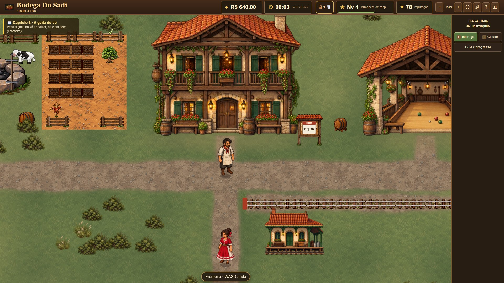
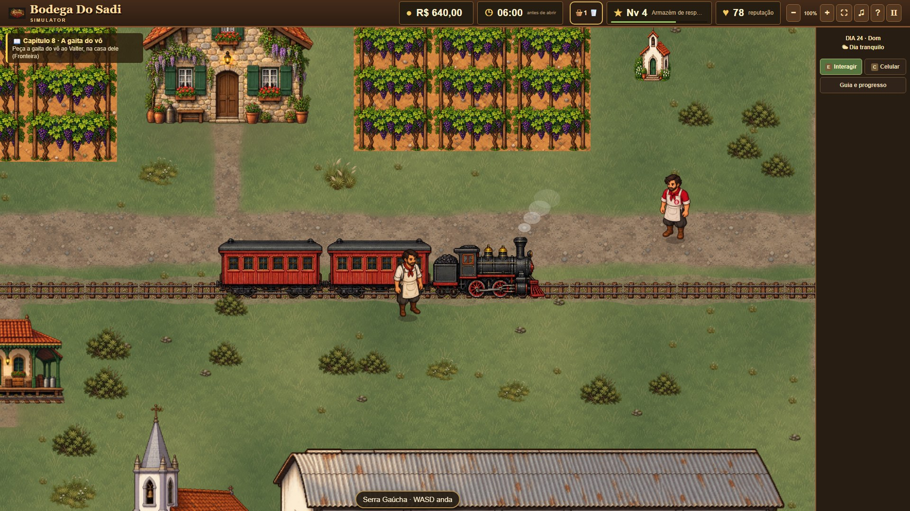
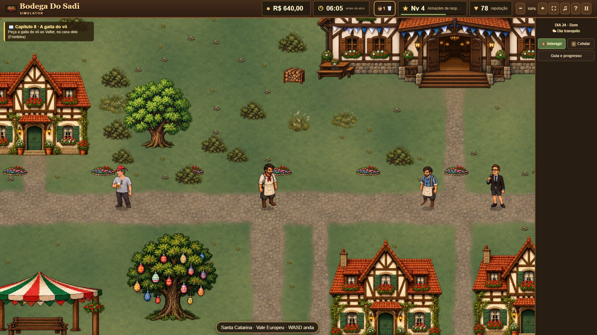
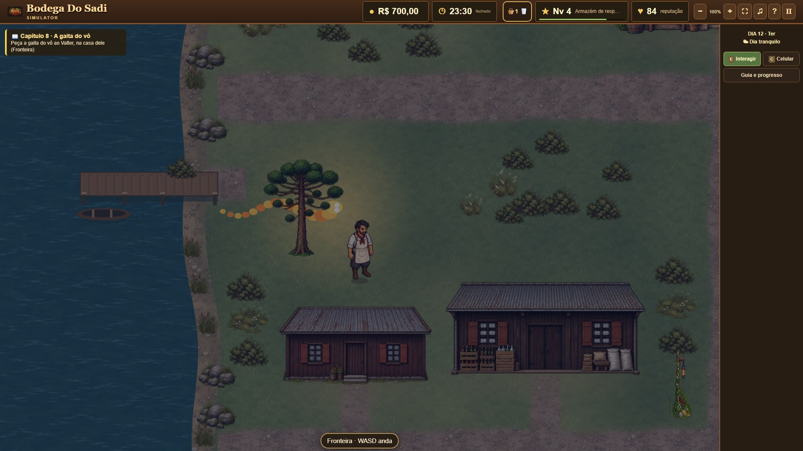
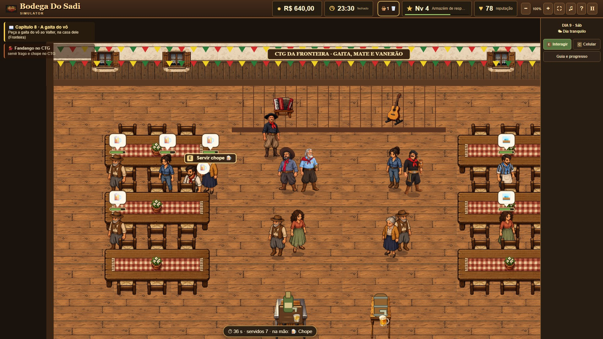
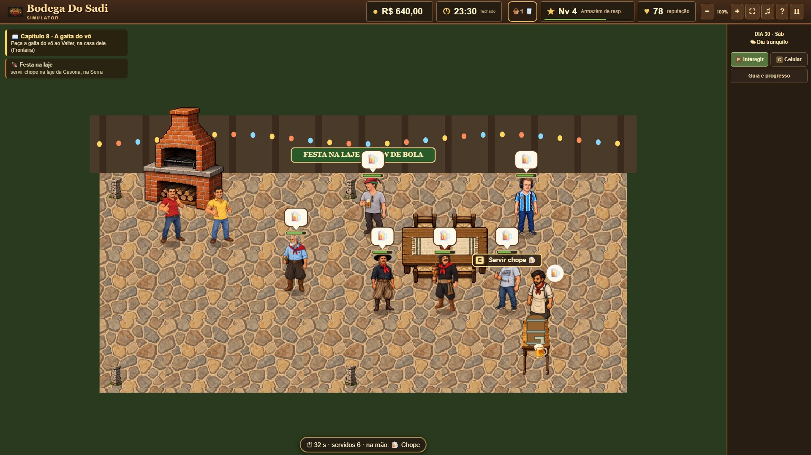
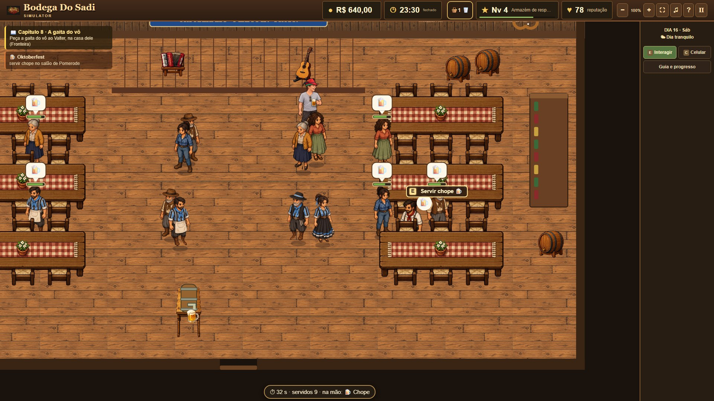
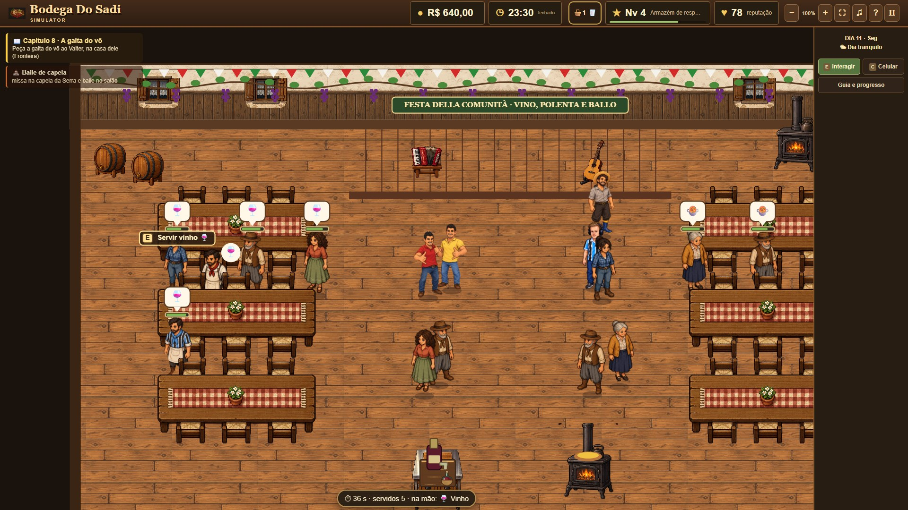
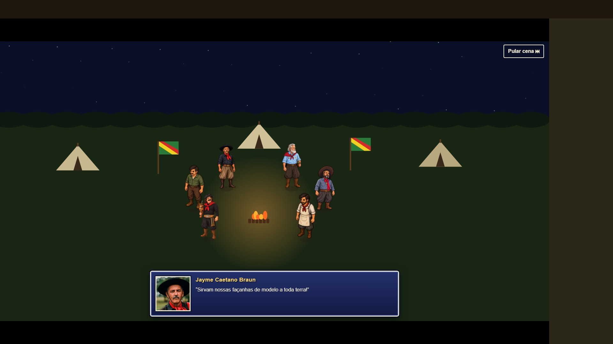
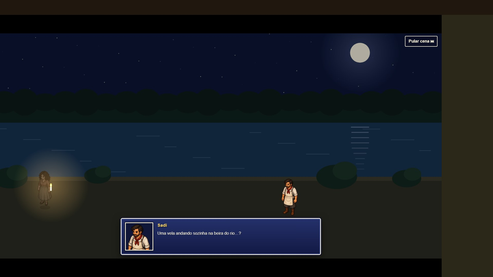

Como jogar: Extrair e abrir index no navegador

## Prints

### Mundo aberto

Fora da bodega dá para andar a pé pela Fronteira, pela Serra Gaúcha e pelo Vale Europeu, prosear com o povo, comprar nas lojas e achar os segredos de cada região.

| | |
|---|---|
|  |  |
| **Fronteira:** a bodega, a horta, a cancha de bocha e o quadro com o calendário de eventos. | **Serra Gaúcha:** parreirais, a casa de pedra do Badin e a Maria Fumaça passando. |
|  |  |
| **Vale Europeu:** casas enxaimel e a árvore de Páscoa de Pomerode. | **Segredos da noite:** o Boitatá serpenteia no banhado, perto do rio. |

### Eventos da semana

Os eventos ficam no calendário. Em cada um, o Sadi serve no balcão enquanto a festa acontece.

| | |
|---|---|
|  |  |
| **Fandango no CTG:** trago e chope enquanto os pares dançam vanerão. | **Festa na laje da Casona:** só os especiais, churrasco do Márcio e do Marcelo, e o Sadi na chopeira. |
|  |  |
| **Oktoberfest:** chope no salão de Pomerode. | **Baile de capela:** depois da missa, vinho e polenta no salão italiano. |
|  |  |
| **20 de Setembro:** acampamento farroupilha, fogo de chão e a história contada pelo Valter. | **Negrinho do Pastoreio:** uma vela andando sozinha na beira do rio. |
